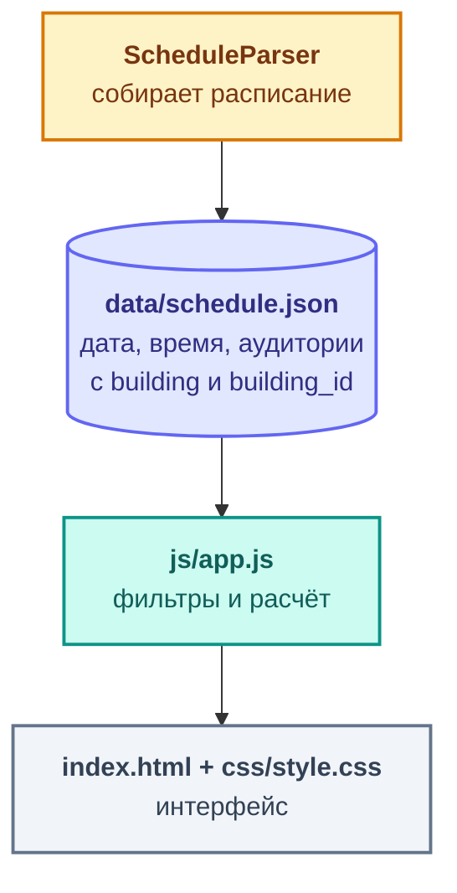

<p align="center">
  
</p>

<h1 align="center"> Поиск свободных аудиторий </h1>
<p align="center">
  Статический сайт для поиска свободных аудиторий по корпусу, дате и паре на основе расписания, собранного ScheduleParser.
</p>

<p align="center">
  
  
  
  
</p>

## О проекте

Расписание МГТУ им. Баумана собирается проектом **ScheduleParser** в файл `schedule.json`. В нём уже есть дата, время, группа, преподаватели и аудитории с корпусом:

```json
"audiences": [
  { "name": "515ю", "building": "A1 ГУК", "building_id": 22 }
]
```

`FreeAuditoriums` — статический сайт без backend, который читает этот JSON и показывает, какие аудитории свободны в выбранном корпусе на выбранную дату и пару.

**Основные задачи:**

-  **Загрузка:** читает `data/schedule.json` через Fetch API.
-  **Фильтрация:** по дате, корпусу и (опционально) паре.
-  **Расчёт:** вычитает занятые аудитории из всех аудиторий корпуса.
-  **Отображение:** адаптивная таблица или карточки в фирменной бирюзовой гамме.

## Возможности MVP

- Выбор даты через `<input type="date">`.
- Выбор корпуса — список строится **динамически** из `schedule.json`.
- Выбор пары: «все пары», 1-я … 7-я.
- Список свободных аудиторий на выбранный день.
- Список свободных аудиторий на конкретную пару.
- Показ занятых аудиторий и занятий (опционально, как дополнительная панель).
- Адаптивная вёрстка.
- Понятные состояния: загрузка, ошибка, «нет данных на дату», «занятий нет, все аудитории свободны».
- Работа без сборки и без backend.

## Установка и запуск

```bash
git clone https://github.com/Digital-SGN/FreeAuditoriums
cd FreeAuditoriums

# fetch локального JSON не работает через file://
python -m http.server 8000
```

Открыть: `http://localhost:8000`.

Для GitHub Pages — положить сайт в репозиторий и включить Pages. `data/schedule.json` должен быть доступен по относительному пути.

## Данные

Сайт использует **только** `data/schedule.json`, который кладёт туда ScheduleParser. Отдельный `buildings.json` не нужен — корпус уже есть в каждой аудитории.

### Формат аудитории

```json
"audiences": [
  { "name": "515ю", "building": "A1 ГУК", "building_id": 22 }
]
```

- `name` — номер/название аудитории (`"515ю"`, `"804"`, `"каф. ФВ"`).
- `building` — человекочитаемое имя корпуса (`"A1 ГУК"`, `"B1 ХимЛаб"`, `"E1 УЛК"`, `"B4, B4K ЦК \"Конгресс-холл\""`). **Может быть `null`.**
- `building_id` — числовой ID блока внутри корпуса. **Не уникален для корпуса** — у одного `"A1 ГУК"` может быть несколько `building_id` (21, 22, …).

### Правила работы с данными

1. **Фильтр по корпусу — по строке `building`, не по `building_id`.** Один корпус может содержать несколько `building_id`.
2. **`building: null`** (например, `"каф. ФВ"`) — не физическая аудитория. Исключать из списка аудиторий корпуса и из расчёта занятости.
3. **`audiences: []`** — занятие без назначенной аудитории («Самостоятельная работа», «ВУЦ»). Не делает ни одну аудиторию занятой, но и не означает «все свободны».
4. **Аудитория идентифицируется парой `(building, name)`.** `"515ю"` в `A1 ГУК` и `"515ю"` в другом корпусе — разные аудитории.
5. **`lesson_type`** может быть `lecture`, `seminar`, `lab`, `other`, `generated`. Для «свободна/занята» не влияет, используется только для подписи.

## Настройка

`js/config.js`:

```js
window.APP_CONFIG = {
  scheduleUrl: "./data/schedule.json",
  timeSlots: [
    { id: 1, start: "08:30", end: "10:05" },
    { id: 2, start: "10:10", end: "11:40" },
    { id: 3, start: "11:50", end: "13:20" },
    { id: 4, start: "14:05", end: "15:35" },
    { id: 5, start: "15:55", end: "17:25" },
    { id: 6, start: "17:35", end: "19:05" },
    { id: 7, start: "19:15", end: "20:45" }
  ]
};
```

Время пар можно поправить по реальному расписанию — в разных корпусах оно может чуть отличаться.

## Стек технологий

**Frontend:**

-  HTML5
-  CSS3, CSS-переменные
-  Vanilla JavaScript, ES6
-  JSON + Fetch API

**Инфраструктура:**

-  GitHub Pages или любой статический хостинг
-  Локально — `python -m http.server`

Без фреймворков, без сборки, без npm.

## Архитектура



## Логика расчёта

1. Пользователь выбирает дату и корпус; при необходимости — пару.
2. Сайт берёт из `schedule.json` все занятия, у которых:
   - `date === selectedDate`;
   - есть хотя бы одна аудитория с `building === selectedBuilding` и `building !== null`;
   - при выбранной паре — пересечение по времени с этой парой.
3. Все аудитории выбранного корпуса = множество `name` из отфильтрованных занятий.
4. Занятые аудитории = те, у которых в выбранный день/пару есть занятие.
5. Свободные = все − занятые.

### Различие состояний

- **«Нет данных на эту дату»** — дата вне диапазона `schedule.json` (до первой или после последней).
- **«Занятий нет»** — дата есть в данных, но занятий для корпуса не нашлось; все известные аудитории свободны.
- **«Занятий без аудиторий»** — занятия есть, но `audiences: []`; на список свободных это не влияет.

## Пример данных

```json
[
  {
    "date": "2026-12-09",
    "group_name": "ИУ5-75Б",
    "discipline": "Технология конструирования ЭВМ",
    "start_time": "10:10",
    "end_time": "11:40",
    "teachers": ["Арина Александровна Адамова"],
    "audiences": [
      { "name": "515ю", "building": "A1 ГУК", "building_id": 22 }
    ],
    "lesson_type": "lecture",
    "week_type": "all",
    "day_of_week": 3
  }
]
```

## Дизайн

Фирменная бирюзовая гамма:

```css
:root {
  --primary: #0CBFA1;
  --primary-dark: #148C9C;
  --secondary: #09707C;
  --dark: #2d3748;
  --light: #f7fafc;
  --gradient: linear-gradient(135deg, var(--primary) 0%, var(--primary-dark) 50%, var(--secondary) 100%);
}
```

## Примерная структура проекта

```text
FreeAuditoriums/
├── index.html
├── css/
│   └── style.css
├── js/
│   ├── app.js          — загрузка данных, фильтры, расчёт
│   └── config.js       — путь к JSON, пары, настройки
├── data/
│   └── schedule.json   — расписание из ScheduleParser
├── assets/             — если будут всякие ассеты  
└── README.md
```

## MVP-функционал

**Пользователь:**

- выбирает дату;
- выбирает корпус;
- выбирает пару или «все пары»;
- видит список свободных аудиторий;
- при желании видит занятые аудитории и занятия.

**Сайт:**

- загружает `schedule.json`;
- фильтрует занятия;
- считает свободные аудитории;
- показывает результат;
- корректно работает на телефоне;
- не падает при пустом списке, отсутствии аудиторий или ошибке загрузки.

## Что критично с самого начала

1. **Фильтр по корпусу — строка `building`, не по `building_id`.** В данных один корпус (`"A1 ГУК"`) встречается с разными `building_id` (21, 22). Фильтрация по `building_id` покажет неполный список занятых аудиторий.
2. **`building: null`** — не физическая аудитория. Исключать из списка корпуса и из занятости.
3. **`audiences: []`** — занятие без аудитории. Не делает аудитории занятыми и не означает «все свободны».
4. **Аудитория = `(building, name)`.** Одинаковые номера в разных корпусах — разные аудитории.
5. **Список корпусов строится динамически** из `schedule.json`, без хардкода.
6. **Различать «нет данных» и «нет занятий».** Иначе пользователь решит, что всё свободно, хотя дата вне диапазона.
7. **Локально — только через `http.server` или Pages.** `fetch()` из `file://` не работает.
8. **Нормализация номеров.** `"515ю"`, `"515 Ю"`, `"515ю "` — приводить к единому виду.
9. **Мобильная версия обязательна.** Большинство будет открывать с телефона.
10. **Понятные ошибки загрузки.** Если `schedule.json` не найден или битый — сообщение, а не пустой экран.

## Критерии приёмки

- Сайт открывается на GitHub Pages или локальном сервере.
- Пользователь может выбрать дату, корпус и пару.
- Свободные аудитории считаются корректно по `schedule.json`.
- `building: null` и `audiences: []` не ломают расчёт.
- На телефоне интерфейс не ломается.
- Ошибки загрузки JSON показываются понятным сообщением.
- Используется заданная бирюзовая гамма.
