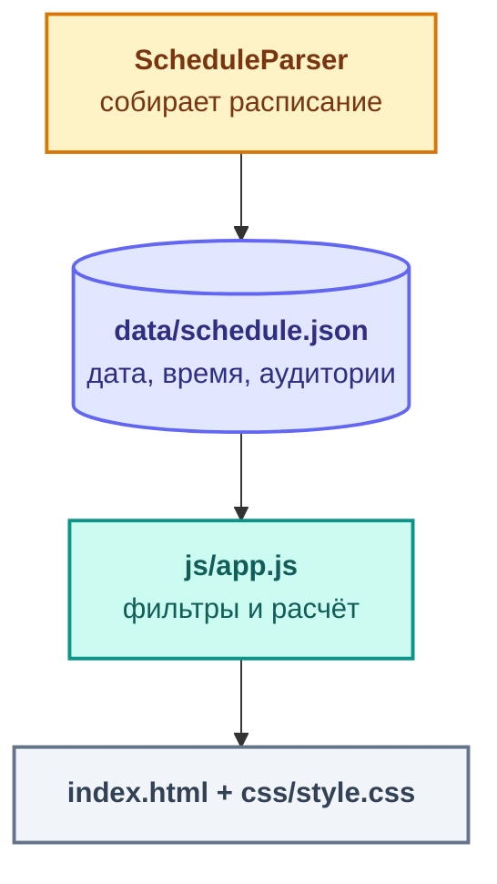

<p align="center">
  
</p>

<h1 align="center"> Поиск свободных аудиторий </h1>
<p align="center">
  Статический сайт для поиска свободных аудиторий по корпусу, дате и паре на основе расписания, собранного ScheduleParser.
</p>

<p align="center">
  
  
  
  
</p>

## О проекте

Расписание МГТУ им. Баумана собирается проектом **ScheduleParser** в файл `schedule.json`. В нём уже есть дата, время, группа, преподаватели и аудитории с корпусом:

```json
"audiences": [
  { "name": "515ю", "building": "A1 ГУК", "building_id": 22 }
]
```

`FreeAuditoriums` — статический сайт без backend, который читает этот JSON и показывает, какие аудитории свободны в выбранном корпусе на выбранную дату и пару.

**Задачи:**

- **Загрузка:** читает `data/schedule.json`.
- **Фильтрация:** по дате, корпусу и (опционально) паре.
- **Расчёт:** вычитает занятые аудитории из всех аудиторий корпуса.
- **Отображение:** адаптивная таблица или карточки в фирменной бирюзовой гамме.

## Возможности MVP

- Выбор даты через `<input type="date">`.
- Выбор корпуса — список строится **динамически** из `schedule.json`.
- Выбор пары: «все пары», 1-я … 7-я.
- Список свободных аудиторий на выбранный день или конкретную пару.
- Адаптивная вёрстка.
- Понятные состояния: загрузка, ошибка, «нет данных на дату», «занятий нет, все аудитории свободны».

## Данные

Сайт использует **только** `data/schedule.json`.

### Формат аудитории

```json
"audiences": [
  { "name": "515ю", "building": "A1 ГУК", "building_id": 22 }
]
```

- `name` — номер/название аудитории (`"515ю"`, `"804"`, `"каф. ФВ"`).
- `building` — имя корпуса (`"A1 ГУК"`, `"B1 ХимЛаб"`, `"E1 УЛК"`). **Может быть `null`.**
- `building_id` — числовой ID блока внутри корпуса.

### Правила работы с данными

1. **Фильтр по корпусу — строка `building`**
2. **`building: null`** — не физическая аудитория (`"каф. ФВ"`). Исключать из списка корпуса и из занятости.
3. **`audiences: []`** — занятие без аудитории («Самостоятельная работа», «ВУЦ»). Не делает аудитории занятыми и не означает «все свободны».
4. **Аудитория = `(building, name)`.** `"515ю"` в разных корпусах — разные аудитории.
5. **`lesson_type`** (`lecture`, `seminar`, `lab`, `other`, `generated`) влияет только на подпись, не на «свободна/занята».

## Настройка

`js/config.js`:

```js
window.APP_CONFIG = {
  scheduleUrl: "./data/schedule.json",
  timeSlots: [
    { id: 1, start: "08:30", end: "10:05" },
    { id: 2, start: "10:10", end: "11:40" },
    { id: 3, start: "11:50", end: "13:20" },
    { id: 4, start: "14:05", end: "15:35" },
    { id: 5, start: "15:55", end: "17:25" },
    { id: 6, start: "17:35", end: "19:05" },
    { id: 7, start: "19:15", end: "20:45" }
  ]
};
```

## Стек

- **Frontend:** HTML5, CSS3, Vanilla JavaScript.
- **Хостинг:** GitHub Pages.

## Архитектура



## Логика расчёта

1. Пользователь выбирает дату, корпус и (опционально) пару.
2. Из `schedule.json` берутся занятия, у которых:
   - `date === selectedDate`;
   - есть аудитория с `building === selectedBuilding` и `building !== null`;
   - при выбранной паре — пересечение по времени с этой парой.
3. Все аудитории корпуса = множество `name` из этих занятий.
4. Занятые = те, у кого в выбранный день/пару есть занятие.
5. Свободные = все − занятые.

### Состояния

- **«Нет данных на дату»** — дата вне диапазона `schedule.json`.
- **«Занятий нет»** — дата есть, но занятий для корпуса не нашлось; все известные аудитории свободны.
- **«Занятия без аудиторий»** — `audiences: []`; на список свободных не влияет.

## Пример данных

```json
[
  {
    "date": "2026-12-09",
    "group_name": "ИУ5-75Б",
    "discipline": "Технология конструирования ЭВМ",
    "start_time": "10:10",
    "end_time": "11:40",
    "teachers": ["Арина Александровна Адамова"],
    "audiences": [
      { "name": "515ю", "building": "A1 ГУК", "building_id": 22 }
    ],
    "lesson_type": "lecture",
    "week_type": "all",
    "day_of_week": 3
  }
]
```

## Дизайн

```css
:root {
  --primary: #0CBFA1;
  --primary-dark: #148C9C;
  --secondary: #09707C;
  --dark: #2d3748;
  --light: #f7fafc;
  --gradient: linear-gradient(135deg, var(--primary) 0%, var(--primary-dark) 50%, var(--secondary) 100%);
}
```

Шапка с градиентом `--gradient`, светлый фон `--light`, тёмный текст `--dark`, акценты через `--primary`. Карточки или таблица с мягкими тенями, адаптивность под телефон.

## Примерная структура проекта

```text
FreeAuditoriums/
├── index.html
├── css/
│   └── style.css
├── js/
│   ├── app.js          — загрузка данных, фильтры, расчёт
│   └── config.js       — путь к JSON, пары
├── data/
│   └── schedule.json   — расписание из ScheduleParser
├── assets/             — логотип и прочие ассеты
└── README.md
```

## MVP-функционал

**Пользователь:**

- выбирает дату, корпус и пару (или «все пары»);
- видит список свободных аудиторий;
- при желании — занятые аудитории и занятия.

**Сайт:**

- загружает `schedule.json`;
- фильтрует и считает свободные аудитории;
- корректно работает на телефоне;
- не падает на пустых списках, `building: null` и ошибках загрузки.

## Что критично

1. **Фильтр по корпусу — по `building`, не по `building_id`.** У `"A1 ГУК"` бывает 21 и 22; фильтрация по `building_id` покажет неполный список занятых.
2. **`building: null`** — не физическая аудитория. Исключать из списка корпуса и из занятости.
3. **`audiences: []`** — занятие без аудитории. Не делает аудитории занятыми и не означает «все свободны».
4. **Аудитория = `(building, name)`.** Одинаковые номера в разных корпусах — разные аудитории.
5. **Список корпусов — динамически** из `schedule.json`, без хардкода.
6. **Различать «нет данных» и «нет занятий».**
7. **Нормализация номеров.** `"515ю"`, `"515 Ю"`, `"515ю "` приводить к единому виду.
8. **Понятные ошибки загрузки.** Если `schedule.json` не найден или битый — сообщение, а не пустой экран.

## Критерии приёмки

- Сайт открывается на GitHub Pages.
- Можно выбрать дату, корпус и пару.
- Свободные аудитории считаются корректно по `schedule.json`.
- `building: null` и `audiences: []` не ломают расчёт.
- На телефоне интерфейс не ломается.
- Ошибки загрузки JSON показываются понятным сообщением.
- Используется заданная бирюзовая гамма.
